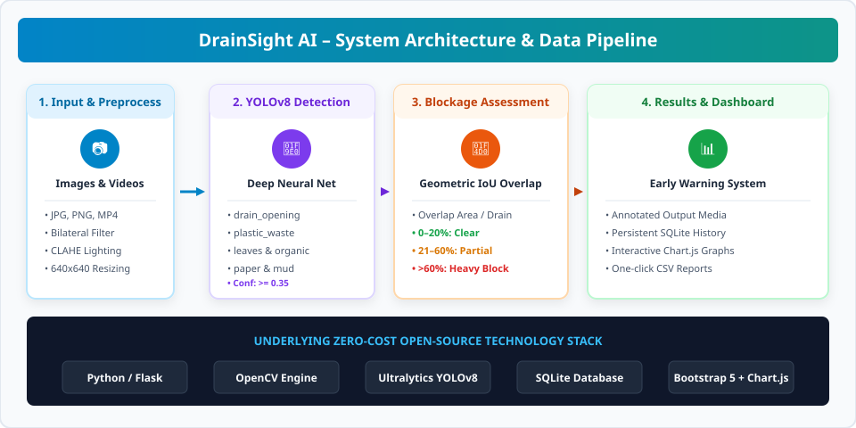

# DrainSight AI – Intelligent Drainage Monitoring System

> An AI-powered, computer-vision web application that inspects drainage systems, detects visible debris, calculates obstruction percentages, and delivers early warning alerts to prevent water stagnation and urban flash flooding—without requiring physical sensors.



---

## 📌 Project Overview

Urban storm drains and roadside gutters are frequently blocked by accumulated solid waste such as plastic bottles, plastic bags, leaves, paper debris, and silt sludge. When monsoon or heavy rains arrive, blocked drains cause rapid water stagnation, traffic disruption, mosquito breeding, and severe urban flooding.

Traditional inspection methods depend on hazardous, labor-intensive manual inspections or delicate submerged physical sensors (ultrasonic level transmitters, flowmeters) that quickly corrode and foul.

**DrainSight AI** solves this through a non-contact computer vision approach:
1. Users upload standard digital photos or video clips of drains.
2. **OpenCV** performs noise reduction (Bilateral filtering) and adaptive contrast enhancement (**CLAHE**) for low-light conditions.
3. An **Ultralytics YOLOv8** deep learning model locates the `drain_opening` and identifies 4 categories of waste: `plastic_waste`, `leaves`, `paper_waste`, and `mud_sediment`.
4. Mathematical geometric **IoU (Intersection-over-Union)** calculates the exact percentage of the drainage aperture covered by debris.
5. The system stratifies the drainage condition into **Clear (0–20%)**, **Partially Blocked (21–60%)**, or **Heavily Blocked (>60%)**, issues advisory warning messages, logs telemetry to an SQLite database, and presents findings on an interactive dashboard with CSV export capabilities.

---

## 🛠️ Free & Beginner-Friendly Tech Stack

| Component | Technology | Description |
|---|---|---|
| **Frontend** | HTML5, CSS3, JavaScript, Bootstrap 5.3 | Responsive, mobile-friendly interface with water/drainage theme |
| **Icons & Charts** | Bootstrap Icons, Chart.js 4.4 | Real-time donuts & bar charts for waste telemetry |
| **Backend** | Python 3.10+ / Flask | Lightweight, performant microframework |
| **Computer Vision** | OpenCV (cv2), NumPy | Bilateral filtering, CLAHE lighting, Watershed segmentation, video frame processing |
| **Deep Learning** | Ultralytics YOLOv8 | Anchor-free object detection for drain rims and waste items |
| **Database** | SQLite 3 (`instance/drainsight.db`) | Zero-configuration relational storage for inspection history |
| **Production Server** | Gunicorn | Production WSGI HTTP server |
| **Free Deployment** | Render (Free Tier), GitHub | Free hosting for Flask backend + web UI |
| **Alternative Hosting** | Vercel / Netlify / Hugging Face Spaces | Optional decoupled frontend or Docker container deployment |

> **Zero Paid Services:** Requires no paid cloud GPUs, no paid APIs, and no subscription platforms.

---

## 📁 Project Directory Structure

```
drainsight-ai/
│
├── app.py                      # Main Flask web application (routes, file handling, telemetry)
├── config.py                   # Centralized configuration (thresholds, paths, limits)
├── detector.py                 # Computer Vision engine (OpenCV preprocessing, YOLOv8 inference, IoU math)
├── database.py                 # SQLite database helper (CRUD, statistics, CSV reporting)
├── train_model.py              # Training script to train YOLOv8 on custom drainage datasets
├── generate_dataset.py         # Utility to create synthetic samples and demo test images
├── data.yaml                   # YOLOv8 dataset configuration file
├── requirements.txt            # Python dependencies
├── Procfile                    # Render / Heroku production process declaration
├── runtime.txt                 # Python runtime version
├── README.md                   # Complete system documentation and guides
│
├── models/
│   ├── best.pt                 # Trained YOLOv8 model weights (or place your weights here)
│   └── README.md               # Model placement instructions
│
├── dataset/                    # Drainage dataset in standard YOLO format
│   ├── images/
│   │   ├── train/              # Training images
│   │   ├── val/                # Validation images
│   │   └── test/               # Test evaluation images
│   └── labels/
│       ├── train/              # YOLO normalized bounding box text files
│       ├── val/
│       └── test/
│
├── static/
│   ├── css/
│   │   └── style.css           # Custom styles (blue, teal, white, dark-gray theme)
│   ├── js/
│   │   └── main.js             # Drag-and-drop uploads, validation, progress, Chart.js
│   └── images/
│       ├── drain_hero.svg      # Vector illustration for landing page
│       ├── architecture.svg    # System architecture vector diagram
│       └── samples/            # 3 sample images for one-click instant demo testing
│
├── templates/
│   ├── base.html               # Base layout with navbar, notifications, and footer
│   ├── index.html              # Home page with hero, overview, stats, and instant demo
│   ├── upload_image.html       # Image upload with drag & drop and sample picker
│   ├── upload_video.html       # Video upload with frame sampling parameters
│   ├── result.html             # Diagnosis page with side-by-side media and gauges
│   ├── dashboard.html          # Analytics dashboard with Chart.js and history table
│   ├── how_it_works.html       # 6-step workflow, formulas, and architecture breakdown
│   └── about.html              # SIMATS Engineering background, literature, limitations
│
├── uploads/                    # Local storage for raw uploaded media
├── outputs/                    # Local storage for annotated images and videos
└── instance/
    └── drainsight.db           # SQLite database for persistent historical telemetry
```

---

## 🚀 Quick Start Guide (Run Locally)

### 1. Prerequisites
- Python 3.10, 3.11, 3.12, or 3.13 installed on your computer.
- Git installed.

### 2. Clone or Navigate to the Project
```bash
cd "drainsight-ai"
```

### 3. (Recommended) Create and Activate a Virtual Environment
- **On Windows (PowerShell):**
  ```powershell
  python -m venv venv
  .\venv\Scripts\Activate.ps1
  ```
- **On Linux / macOS:**
  ```bash
  python3 -m venv venv
  source venv/bin/activate
  ```

### 4. Install Dependencies
```bash
pip install -r requirements.txt
```

### 5. Generate Dataset & Sample Images (Already Pre-generated)
If you wish to re-generate the 20 dataset images and demo samples:
```bash
python generate_dataset.py
```

### 6. Run the Flask Web Application
```bash
python app.py
```

Open your browser and navigate to:
```
http://127.0.0.1:5000
```

---

## 🧠 YOLOv8 Model Training Guide

The system includes a dedicated training script `train_model.py` and dataset configuration `data.yaml`.

### Detectable Classes:
```yaml
names:
  0: drain_opening
  1: plastic_waste
  2: leaves
  3: paper_waste
  4: mud_sediment
```

### Step 1: Prepare Your Dataset
1. Collect or download drainage images (e.g., from Roboflow or smartphone cameras).
2. Annotate with bounding boxes in YOLO format (`class_id x_center y_center width height` normalized 0.0 to 1.0).
3. Place images and label files in:
   - `dataset/images/train` and `dataset/labels/train`
   - `dataset/images/val` and `dataset/labels/val`
   - `dataset/images/test` and `dataset/labels/test`

### Step 2: Train the Model
Run the training script:
```bash
python train_model.py --epochs 30 --batch 8 --imgsz 640 --device cpu
```
*(If you have an NVIDIA GPU, set `--device 0` for ultra-fast training).*

### Step 3: Deployment of Weights
The script will automatically copy the best resulting weights to `models/best.pt`.
Once `models/best.pt` is present, DrainSight AI automatically switches from the OpenCV fallback detector to active YOLOv8 deep learning inference!

> **Note on Placeholder Mode:** If `models/best.pt` has not been added yet, the application gracefully activates an intelligent OpenCV heuristic fallback detector. The UI displays a notification:
> `“Please add your trained YOLO model file at models/best.pt.”`
> while still permitting complete end-to-end testing of uploads, video processing, database recording, and reporting!

---

## 📐 Blockage Estimation Formulation

The blockage estimation algorithm avoids simple naive object counting. Instead, it computes true geometric obstruction using digital binary masks:

$$\text{Blockage Percentage} = \frac{\text{Area}(\Omega_{\text{drain}} \cap \Omega_{\text{waste}})}{\text{Area}(\Omega_{\text{drain}})} \times 100\%$$

Where:
- $\Omega_{\text{drain}}$ is the spatial aperture of the drainage opening or culvert mouth.
- $\Omega_{\text{waste}} = \bigcup_{i=1}^{M} \Omega_i$ is the merged union of all detected plastic, leaves, paper, and mud debris masks.

### Risk Stratification Standards:
- **0% – 20% (Clear):** Drainage flow is unhindered. No immediate action required.
  - *Warning:* `Drain is clear. No major visible obstruction detected.`
- **21% – 60% (Partially Blocked):** Moderate obstruction. Water flow velocity is reduced.
  - *Warning:* `Partial blockage detected. Cleaning is recommended to prevent accumulation.`
- **Above 60% (Heavily Blocked):** Severe obstruction. Extreme risk of flash flooding and water stagnation.
  - *Warning:* `Heavy blockage detected. Immediate cleaning is required to prevent water stagnation and flooding.`
- **No Opening Detected:**
  - *Warning:* `Drain opening not clearly detected. Please upload a clearer image or video.`

---

## 🌐 Free Cloud Deployment (Step-by-Step on Render)

Deploy your application for free on [Render](https://render.com):

1. **Push your code to a GitHub repository:**
   ```bash
   git init
   git add .
   git commit -m "Initial commit of DrainSight AI"
   git branch -M main
   git remote add origin https://github.com/<your-username>/drainsight-ai.git
   git push -u origin main
   ```

2. **Log into Render:**
   Sign up or log in at [dashboard.render.com](https://dashboard.render.com) using your GitHub account.

3. **Create a New Web Service:**
   - Click **New +** > **Web Service**.
   - Select **Build and deploy from a Git repository**.
   - Connect your `drainsight-ai` repository.

4. **Configure Web Service Settings:**
   - **Name:** `drainsight-ai`
   - **Region:** Any close to you (e.g., Oregon, Frankfurt, Singapore).
   - **Branch:** `main`
   - **Runtime:** `Python 3`
   - **Build Command:**
     ```bash
     pip install -r requirements.txt
     ```
   - **Start Command:**
     ```bash
     gunicorn app:app --workers=2 --threads=2 --timeout=120
     ```
   - **Plan Type:** Select **Free** (0.5 CPU, 512 MB RAM).

5. **Deploy:**
   Click **Create Web Service**. Render will clone the repository, install dependencies, and launch Gunicorn.

6. **Open Live App:**
   Once the status indicates `Live`, open the generated URL (e.g., `https://drainsight-ai.onrender.com`).

> **Render Free Tier Tips for College Demos:**
> - Render's free tier spins down after 15 minutes of inactivity; the first request after sleep may take ~30–50 seconds to wake up.
> - Because free instances have 512MB RAM, upload small images (< 3MB) and short video clips (< 10 seconds) during your presentation.

---

## 🔄 Alternative Deployment Options

### Option A: Hugging Face Spaces (Free Tier)
1. Create a free account on [huggingface.co](https://huggingface.co).
2. Create a new Space with the **Docker** or **Gradio/Flask** SDK.
3. Push the `drainsight-ai` repository. Hugging Face Spaces provides 16GB free RAM, which easily supports larger YOLO models and longer videos.

### Option B: Decoupled Frontend (Vercel / Netlify) + Local Backend
If you want to host the frontend on Netlify or Vercel:
1. Export static HTML/CSS/JS to a frontend repo.
2. Run the Flask backend locally on your laptop:
   ```bash
   python app.py
   ```
3. Enable CORS in Flask:
   ```bash
   pip install flask-cors
   ```
   Add in `app.py`:
   ```python
   from flask_cors import CORS
   CORS(app)
   ```
4. Point frontend API requests to `http://localhost:5000` or an ngrok tunnel.

---

## 🎓 College Viva & Project Presentation Questions

1. **Why not use physical ultrasonic water-level sensors?**
   *Answer:* Physical sensors submerged inside drains are subject to corrosive wastewater, rat tampering, silt accumulation, and battery exhaustion. Computer vision provides non-contact, remote inspection using standard mobile phones or CCTV without ongoing maintenance costs.

2. **Why is YOLOv8 preferred over older YOLO versions or R-CNN?**
   *Answer:* YOLOv8 is an anchor-free single-stage object detector that processes images in a single forward pass, providing high frame rates (suitable for real-time video) with low computational footprint on edge devices and CPUs.

3. **How is the blockage percentage calculated?**
   *Answer:* It calculates the non-overlapping intersection area (in pixels) between all detected waste object bounding boxes and the primary drain opening bounding box, divided by the drain opening area, multiplied by 100.

4. **What are the primary project limitations?**
   *Answer:* It provides 2D surface visual inspection; it cannot inspect underground pipe structural collapses beneath the water surface, and requires daylight or auxiliary illumination.

---

## 📄 License & Attribution

Developed as an Academic Engineering Project at **SIMATS Engineering** (Saveetha Institute of Medical and Technical Sciences).
Released under the **MIT License**. Free for educational and research use.
